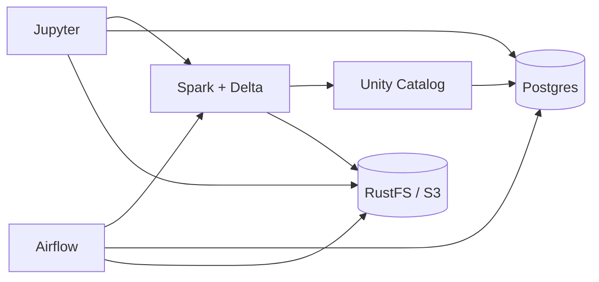

# lakehouse-lab

A small data engineering lab in Docker, close to Databricks and AWS, running entirely on your own machine.
Everything is connected and there is a hello world for each part. Nothing more.

| Here | Stands in for | Version |
|---|---|---|
| **Spark Connect** + **Delta Lake** | Databricks Runtime / Databricks Connect, EMR | 4.2.0 + 4.4.1 |
| **Unity Catalog** (open source) | Databricks Unity Catalog, AWS Glue Catalog | 0.7.0 |
| **RustFS** | S3 | 1.0.6 |
| **Airflow** | Databricks Jobs, Amazon MWAA | 3.4.0 |
| **Postgres** | Amazon RDS | 18.7 |
| **JupyterLab** | Databricks notebooks | 4.6 |



Jupyter and Airflow are thin clients: your code runs on the Spark server, the way Databricks Connect works.

## Run it on a PC

You need Docker with Compose. On Windows, run the commands inside WSL.

```sh
git clone https://github.com/healta/lakehouse-lab && cd lakehouse-lab
sh make-env.sh          # prints your password
docker compose up -d
```

The first start downloads the images (about 2 GB). Later starts take under a minute.

| | Address | Login |
|---|---|---|
| Airflow | http://localhost:28080 | `lab` + password |
| Jupyter | http://localhost:28888 | password |
| RustFS console | http://localhost:29001 | `lab` + password |
| S3 API | http://localhost:29000 | `lab` + password |
| Postgres | localhost:25432, database `warehouse` | `lab` + password |
| Spark UI | http://localhost:24040 | none, this machine only |
| Unity Catalog API | http://localhost:28081 | none, this machine only |
| Spark Connect | sc://localhost:15002 | none, this machine only |

The password is the same everywhere. It is in `.env`.

### Hello world

* **Jupyter**: open `notebooks/hello_world.ipynb` and run all cells.
* **Airflow**: open the `hello_world` DAG and press Trigger.

Both write a Delta table through Unity Catalog, put a file in S3 and ask Postgres for its version.

Your own notebooks go in `notebooks/` and your DAGs in `dags/`. Both folders are also visible inside Jupyter.

### How to reach things from code

```python
# Jupyter: everything is preconfigured
spark = SparkSession.builder.getOrCreate()
spark.table("main.default.my_table")                   # Unity Catalog
spark.read.csv("s3://lakehouse/raw/file.csv")          # S3 by path
boto3.client("s3")
psycopg.connect()
```

In Airflow use the default connections: `@task.pyspark(conn_id="spark_connect_default")`, `S3Hook()`, `PostgresHook()`.

### Keep it running on Windows

WSL stops a distro when nothing uses it, and the lab with it. To keep it on, put this in
`C:\Users\<you>\.wslconfig` and run `wsl --shutdown` once:

```ini
[general]
instanceIdleTimeout=-1

[wsl2]
vmIdleTimeout=-1
```

After a reboot, start WSL once (`wsl -d Ubuntu true`) and the containers come back by themselves.

## Deploy on TrueNAS

TrueNAS 24.10 or newer. In the steps below, replace `/mnt/pool` with your pool.

1. **Datasets → Add Dataset**: name `lakehouse-lab`, preset **Generic**. (Not the SMB or Apps preset: Postgres has to set its own file permissions.)
2. **System → Shell**:

   ```sh
   cd /mnt/pool/lakehouse-lab
   curl -L https://github.com/healta/lakehouse-lab/archive/refs/heads/main.tar.gz | sudo tar xz --strip-components=1
   sudo sh make-env.sh truenas
   ```

   Write down the password it prints.
3. **Apps → Discover Apps → ⋮ → Install via YAML**: name `lakehouse-lab`, and paste:

   ```yaml
   include:
     - path: /mnt/pool/lakehouse-lab/compose.yaml
       env_file: /mnt/pool/lakehouse-lab/.env
   services: {}
   x-portals:
     - {name: Airflow, scheme: http, host: 0.0.0.0, port: 28080, path: /}
     - {name: Jupyter, scheme: http, host: 0.0.0.0, port: 28888, path: /}
   ```

4. Open `http://<truenas-address>:28080`. Same ports as in the table above.

All data is in `data/` inside the dataset, so a TrueNAS snapshot covers everything.

Keep it on your home network. It is plain HTTP, and it is not meant for the internet.

**Update later:** stop the app, then in the shell:

```sh
cd /mnt/pool/lakehouse-lab
curl -L https://github.com/healta/lakehouse-lab/archive/refs/heads/main.tar.gz | sudo tar xz --strip-components=1
sudo sh make-env.sh truenas      # keeps your .env, only repairs file owners
sudo docker compose pull
```

and start the app again. Your data and your own notebooks and DAGs are not touched, only the hello world files are replaced.

## How heavy is it

Measured on a PC after running the hello world:

| | Memory |
|---|---|
| Spark | 1.9 GB (2.6 GB after big jobs), limit it with `SPARK_MEMORY` |
| Airflow (4 containers) | 1.2 GB |
| Unity Catalog | 0.4 GB |
| RustFS | 0.1 GB (0.4 GB after big jobs) |
| Postgres | 0.1 GB |
| Jupyter | 0.1 GB |
| **Total** | **3.8 GB** (4.9 GB after big jobs) |

Plan for 6 GB of free memory and 10 GB of disk. If that is too much:

* Lower `SPARK_MEMORY` in `.env` to `1g`.
* Remove the `airflow-triggerer` service. Only deferrable operators need it.
* Postgres is the lightest part, so replacing it saves nothing. Airflow and Spark are the heavy ones.

## Good to know

* **Versions move together.** Spark 4.3 exists, but Delta Lake and Unity Catalog do not support it yet.
* **`OPTIMIZE` and `VACUUM` are refused on managed tables** by Unity Catalog until Delta 4.5. They work on external
  tables: `CREATE TABLE ... USING DELTA LOCATION 's3://lakehouse/external/name'`.
* **Files of dropped tables** are deleted from S3 after 7 days.
* **RustFS instead of MinIO**: MinIO was archived in 2026. Unity Catalog hands Spark one-hour keys limited to a single
  table; a [small class](images/unity-catalog/RustfsCredentials.java) removes the KMS part of its policy, which RustFS refuses.
* **No login on Spark and Unity Catalog**, so their ports are never opened to your network, only to the machine itself.

## Build the images yourself

```sh
docker compose build
```

GitHub Actions does the same on every change in `images/` and publishes to `ghcr.io/healta/lakehouse-lab-*`.

Licence: [0BSD](LICENSE), do what you like. The bundled software keeps its own licences.
